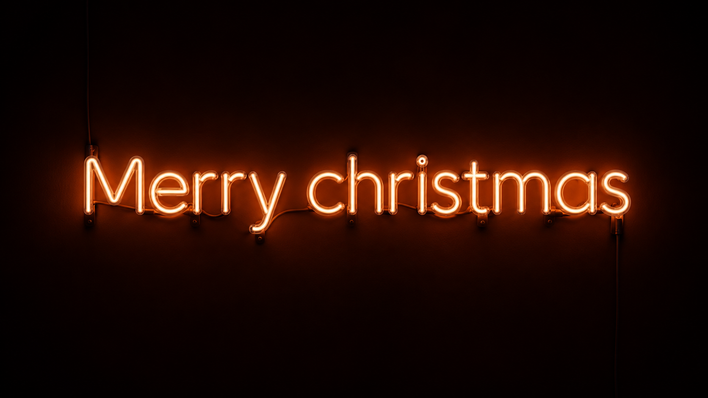

# Neon Sign Text

一个把指定文字变成写实玻璃霓虹灯招牌的 Codex Skill。默认使用深棕近黑的墙面、暖白灯管和琥珀橙光晕，保留固定夹和电线细节。



## 安装

在本机终端运行以下命令。目标目录须尚未存在。

```sh
git clone https://github.com/midboss1028-beep/neon-sign-text.git "${CODEX_HOME:-$HOME/.codex}/skills/neon-sign-text"
```

安装后在 Codex 中开启新对话。如果技能列表没有刷新，重启 Codex。

## 使用

- 生成霓虹灯文字 Merry christmas
- 生成霓虹灯文字「晚安」，冷蓝色，竖屏
- 用 `$neon-sign-text` 生成霓虹灯文字 Open Late

技能按原样保留字样、大小写和标点。只给文字时，默认生成一张横幅图片，无需上传参考图。生成后会检查字样，发现拼写错误时重试一次。

本技能需要运行环境提供内置 ImageGen。仓库包含技能说明和示例图片，不含独立渲染程序。
